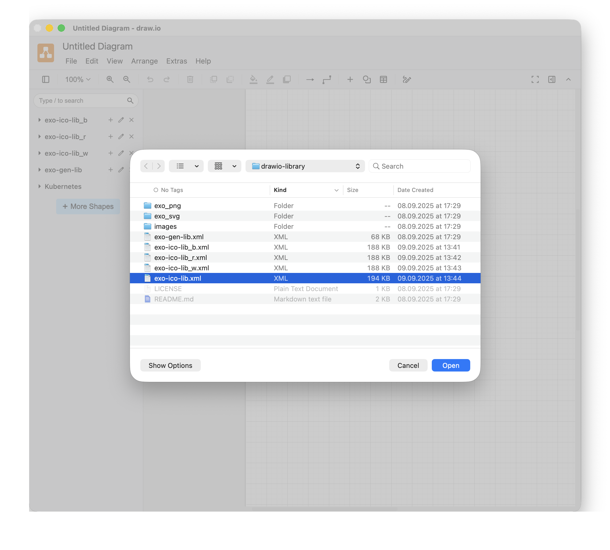
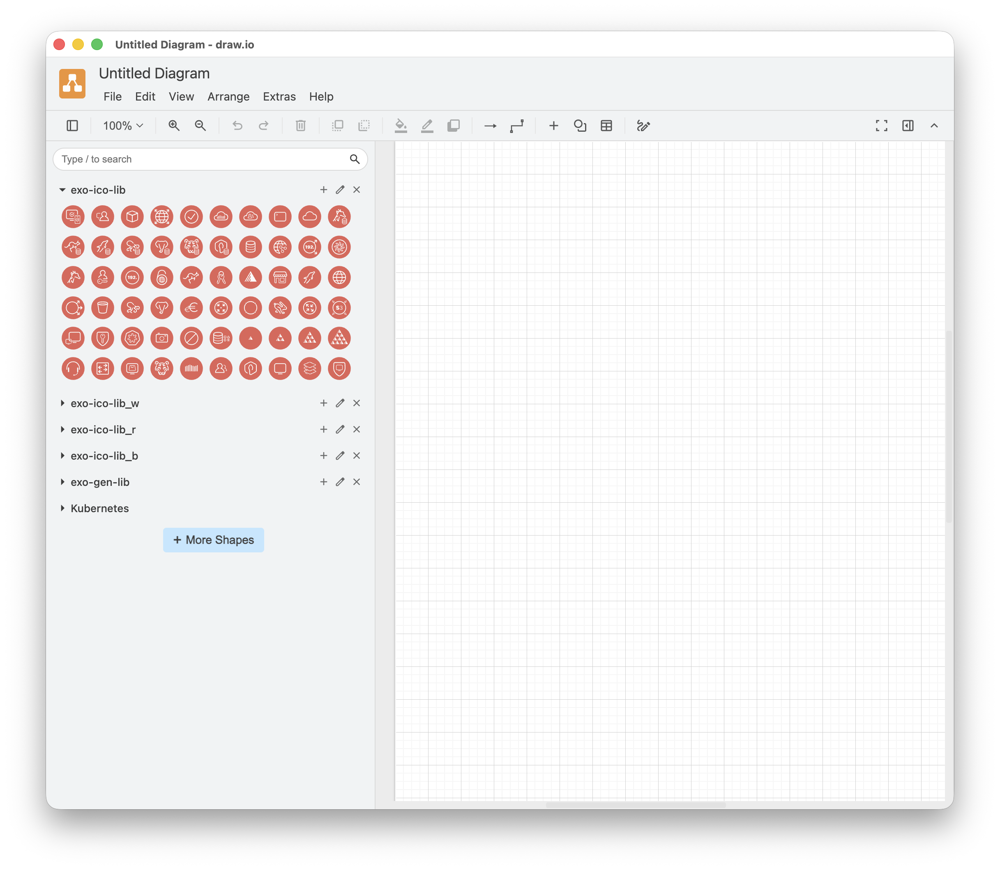
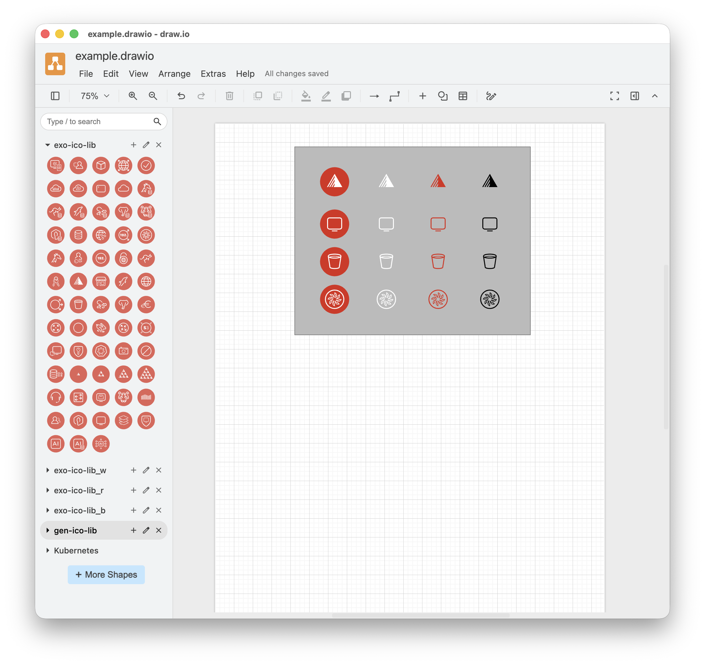

# Exoscale Icon Libraries

The Exoscale `drawio-library` repository offers three categories of icon libraries to help you create clear architecture and infrastructure diagrams with `draw.io`. These libraries work with both the __draw.io Desktop__ app ([Linux, macOS, Windows downloads](https://github.com/jgraph/drawio-desktop/releases)) and the online tool at [app.diagrams.net](https://app.diagrams.net).

> __NOTE__  
  For a detailed guide on using custom libraries, see this [blog post](https://www.drawio.com/blog/custom-libraries).

## Library Categories

1. __Exoscale Products__  
   Official product logos.
2. __Exoscale Icons__  
   Variations of official product logos (black, red, white, and blue line styles).
3. __Generic Icons__  
   General-purpose symbols (e.g., server, router, switch) for larger or cross-platform diagrams.

### Exoscale Products
- File: `exo-ico-lib.xml`  
  Contains the official product logos.

### Exoscale Icons
- Files: `exo-ico-lib_<color-code>.xml`  
  Contains icon variations in different color codes:

| `<color-code>` | Color        |
| :------------- | :----------- |
| `_bk`          | black-line   |
| `_bl`          | blue-line    |
| `_rd`          | red-line     |
| `_wh`          | white-line   |

> __NOTE__  
  Find an up-to-date overview of product icon variations in the [Icon-Overview](https://community.exoscale.com/tools/icon-table/).

### Generic Icons
- File: `gen-ico-lib.xml`  
  Contains general-purpose icons.

## Installation

1. Download the icon archive from [GitHub](https://github.com/exoscale/drawio-library/releases).
2. In draw.io, use the `Open Library...` command from the `File` menu.



## Usage

Once loaded, the icons will appear in the left panel. Click any icon to place it on your canvas. Icons are proportionally sized for consistent diagrams.



## Example



## Repository Layout

The `.xml` library files above are generated from source assets and scripts in
this repository:

| Path                | Contents                                                        |
| :------------------ | :-------------------------------------------------------------- |
| `exo_svg/svg*/`     | Source SVG icons, one folder per color variant (`svg`, `svg_bk`, `svg_bl`, `svg_rd`, `svg_wh`). |
| `exo_png/png*/`     | 256 px PNG renders of every SVG, mirroring the `exo_svg` folders. |
| `new-icons/`        | Staging folder: drop newly added SVG icons here to onboard them. |
| `images/`           | Screenshots used in this README.                                 |
| `*_overview.pdf`    | Paginated visual overviews of the SVG and PNG libraries.         |
| `.agents/skills/`   | Agent skills that drive the maintenance workflows (see below).   |

## Maintaining the Libraries

Adding new icons is a three-step pipeline (run from the repository root):

```bash
python3 make_mini_variants.py    # 1. minimize SVGs in new-icons/ and copy into exo_svg/svg/
python3 make_color_variants.py   # 2. generate the _bk, _bl, _rd and _wh variants
python3 make_png_variants.py     # 3. render the PNG variants into exo_png/
```

Then regenerate the draw.io library files and overview PDFs:

```bash
python3 make_lib_updates.py      # sync exo-ico-lib.xml from exo_svg/svg/ (supports --dry-run)
python3 make_overview.py         # regenerate the SVG/PNG overview PDFs
```

Run `make_lib_updates.py` once per color variant by pointing `--svg-dir` and
the output at the matching pair (e.g. `--rebuild --svg-dir exo_svg/svg_bk --out
exo-ico-lib_bk.xml`); the `regen-libs` skill does all five in one go.

Requirements: `svgo` (step 1; `npx` works as a fallback) and `rsvg-convert` or
`inkscape` (step 3). All scripts are safe by default: existing files are
skipped unless you pass `--force`.

The same workflows are available as agent skills in `.agents/skills/`:
`image-update` (the pipeline above), `regen-libs` (library XML regeneration)
and `image-overview` (overview PDFs).
